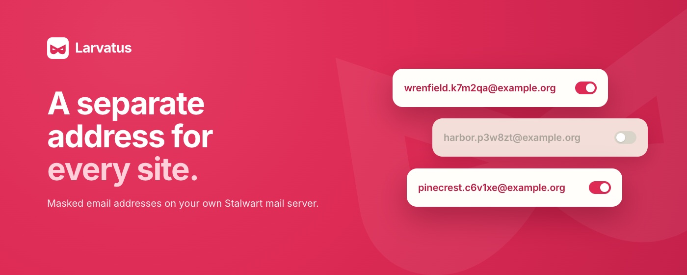
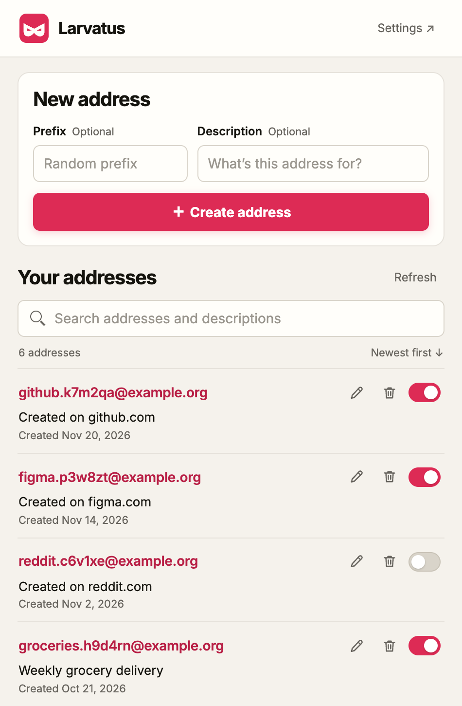

# Larvatus

**Give every site its own email address, from your own Stalwart Mail server.** Larvatus is a browser extension that creates masked email addresses on [Stalwart](https://stalw.art) and fills them in on sign-up forms. When a site starts sending too much mail (or sells your address to someone you've never heard of), you can switch that one address off.

[**Get it for Chromium Browsers**](https://chromewebstore.google.com/detail/larvatus/cpmmagajhncikbcllkonjnoohkhpcioa) · [**Get it for Firefox**](https://addons.mozilla.org/en-US/firefox/addon/larvatus-stalwart-mail-aliases/)

## How It Works

A masked address is a separate address that delivers to the inbox you already use. You give one to each site instead of your real address, so the site never learns what your real one is.

1. **Create an address** when a site asks for your email. Give it a prefix, or leave it blank and get a short random one. Stalwart generates the rest.
2. **Mail arrives in your inbox** through your own Stalwart server, like any other mail.
3. **Switch it off** when you're done with it. Your server rejects mail sent to that address from then on, and you can switch it back on any time.

## The Extension

<picture>
  <source media="(prefers-color-scheme: dark)" srcset="docs/images/popup-dark.png">
  
</picture>

Click the Larvatus button in your toolbar to see every address you've made, newest first, with a note of what it's for. When you open it on a website, the prefix and description are already filled in for that site (`github` and "Created on github.com"), so making an address is one click, but you can edit either one first.

- **Search** by address or description.
- **Copy** an address by clicking it.
- **Switch off** delivery, and switch it back on when you want it.
- **Delete** an address you'll never need again. Larvatus asks you to confirm, because a deleted address is gone for good.

## Sign-Up Forms

Turn on the email field button in **Settings** and Larvatus puts a small button in the email field of sign-up forms. Clicking it creates an address for that site and fills it in. It tries to avoid showing up on sign-in forms (since you don't want a new address every time you log in!)

This is **off by default**, because Larvatus only asks for browser permissions it absolutely needs during installation. To turn the button on, it'll ask for the additional permissions it needs to add the button to the page. You can also choose whether new addresses start with the site's name, one random character, or a prefix of your own, and move the button beside the field if it gets in the way of your password manager's button.

## Privacy

Larvatus has no servers of its own. Your addresses, their descriptions, and your sign-in go to your mail server and nowhere else, and we never receive any of them. There are no analytics, no ads, and no tracking, and Larvatus doesn't read or send the contents of the pages you visit.

You sign in with OAuth on your server's own page, so Larvatus never sees your password. It asks for one permission, access to your account settings (`urn:stalwart:oauth:scope:settings`), which is where Stalwart keeps masked addresses. That doesn't cover your mail, contacts, or calendars. **Settings → Disconnect account** signs you out and revokes Larvatus's access on the server.

There are full details in our [privacy policy](https://larvat.us/privacy/).

## What You Need

You need an account on a Stalwart mail server running version 1.0.3 or later, reachable over HTTPS, with its OAuth server, public client registration, and masked addresses turned on. The server can be one you run yourself, or one a provider runs for you. A current Stalwart install has all of this on by default.

Stalwart only lets each account have **5** masked addresses unless the administrator raises the limit. If you run your own server, the [guide for administrators](https://larvat.us/administrators/) shows you where to change it, along with some other settings worth checking.

Larvatus isn't made by, affiliated with, or endorsed by Stalwart Labs. Stalwart is the free and open-source mail server it works with.

## Who Makes This

Larvatus is free, and it's made by [Triplebit](https://larvat.us/#give), a 501(c)(3) public charity that works on digital rights and privacy education. Triplebit is entirely donor-funded, so if you find it useful, please consider [donating to Triplebit](https://www.every.org/triplebit?code=cccd9fbd#/donate).

*Larvatus* is Latin for "masked" or "disguised." (You may know it from Descartes: *Larvatus prodeo*, "I go forth masked.")

Questions or problems? See [support](https://larvat.us/support/).
